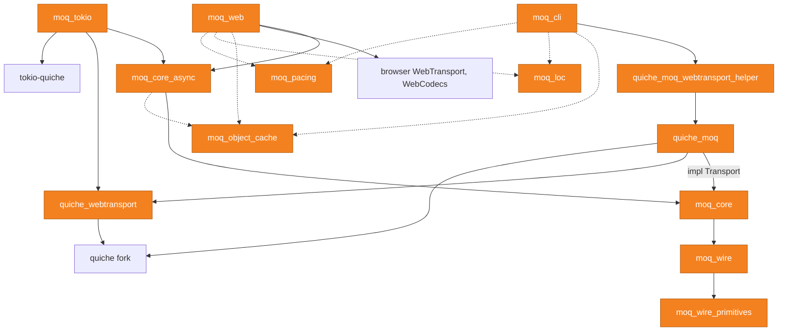

<div align="center">
    
</div>

# QUICHE MoQ

> ⚠️ Not production ready, experimental research code

> This project is not affiliated with [Cloudflare quiche](https://github.com/cloudflare/quiche)

A [Media over QUIC Transport (MoQT)](https://datatracker.ietf.org/doc/draft-ietf-moq-transport/) implementation
for [quiche](https://github.com/cloudflare/quiche), drafts 07 to 19, over WebTransport and native QUIC.

## Contents

Protocol
- [`moq_wire_primitives`](moq_wire_primitives): `no_std` varints, bounded strings, reader and writer
- [`moq_wire`](moq_wire): encoding of MoQT messages, objects and streams, drafts 07 to 19
- [`moq_core`](moq_core): sans-IO session state machine behind a small `Transport` trait, `no_std`
- [`moq_loc`](moq_loc): typed LOC properties (codec config, timestamps, ...)
- [`moq_object_cache`](moq_object_cache): caches reassembling and storing objects by location
- [`moq_pacing`](moq_pacing): playback speed from buffer level

Transports and runtimes
- [`quiche_moq`](quiche_moq): `moq_core` on a quiche connection, examples in [`quiche_moq/examples`](quiche_moq/examples)
- [`quiche_moq_webtransport_helper`](quiche_moq_webtransport_helper): QUIC, WebTransport and MoQ setup for mio endpoints
- [`quiche_webtransport`](quiche_webtransport): WebTransport over HTTP/3 (draft 16) on quiche
- [`moq_core_async`](moq_core_async): runtime-agnostic async API over `moq_core`
- [`moq_tokio`](moq_tokio): async client and server on tokio and tokio-quiche
- [`http_capsule`](http_capsule), [`short_buf`](short_buf), [`quiche_utils`](quiche_utils),
  [`quiche_h3_utils`](quiche_h3_utils), [`quiche_endpoint_utils`](quiche_endpoint_utils): small helpers

Applications
- [`moq_cli`](moq_cli): the `moq` node: publish, subscribe, relay and route tracks
- [`moq_web`](moq_web): browser player on WebTransport and WebCodecs, Rust and WASM

Testing
- [`interop`](interop): [moq-interop-runner](https://github.com/englishm/moq-interop-runner) image and the
  full interop matrix in the Nix sandbox
- [`experiments`](experiments): [nixnet](https://github.com/birneee/nixnet) testbeds, e.g. `nix run .#experiments.web`
- [`check.sh`](check.sh): what CI checks, run in `nix develop`

## Architecture



Orange boxes are crates of this repository, the others external dependencies.

`moq_core` holds all protocol logic and does no I/O. Each platform implements its `Transport`: `quiche_moq` for
mio event loops (`moq_cli`), `moq_core_async` for async callers, with `moq_tokio` natively and `moq_web` in the
browser. Buffering and caching policy stay with the application.

## Features

- drafts 07 to 19, modelled on draft 19 and mapped to each older draft; a feature a draft lacks is refused there
- WebTransport (`https://`) and native QUIC (`moqt://`, draft 15+) sessions
- subscribe, publish, namespace announce and subscribe, SUBSCRIBE_TRACKS, track status and fetch
- request updates, range filters, delivery timeouts, priorities, streams and datagrams
- relaying with namespace re-announcement, multipath subscriptions, race and reconnect of upstreams
- browser player with live WebCodecs video and audio, adaptive playback pacing, stats panels
- typed [LOC](https://datatracker.ietf.org/doc/draft-ietf-moq-loc/) properties, fMP4 demuxing and remuxing
- [qlog](https://datatracker.ietf.org/doc/draft-pardue-moq-qlog-moq-events/) of control messages and objects
- runtime-tunable QUIC transport and padding stream
- fuzzed decoders and sessions, interop tested in [moq-interop-runner](https://github.com/englishm/moq-interop-runner)
  as `birneee-moq`

Drafts before 15 negotiate the version in the SETUP messages, from draft 15 on ALPN or `WT-Available-Protocols`
pin exactly one. Draft 16 is the best tested version.

## Planned Features

- fetch before draft 15
- datagrams before draft 14
- replacing range filters with a request update
- UNSUBSCRIBE_NAMESPACE

## Quick start

```shell
$ nix develop
$ RUST_LOG=info cargo run -p time-server
[INFO  time_server] start server on 0.0.0.0:8080
$ RUST_LOG=info cargo run -p time-client
[INFO  time_client] subscribe clock second
[INFO  time_client] received "2025-10-17T11:37:17.265898446+02:00"
```

## License

MIT, see [LICENSE](LICENSE).
